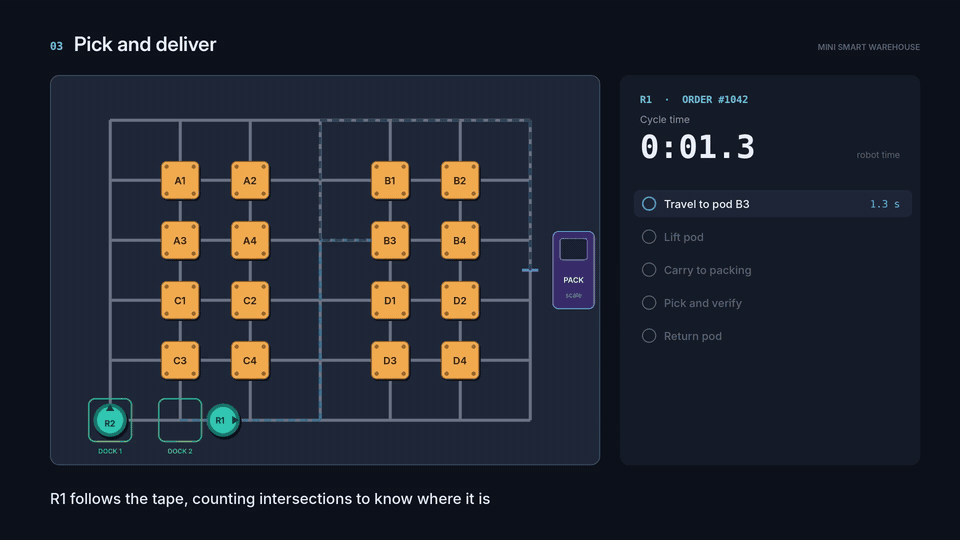

# Mini Smart Warehouse

**A tabletop autonomous fulfillment center: small robots carry shelf pods to a packing station, and a digital twin finds the best way to run it.**



*Concept animation of the planned system. The physical build is in progress.*

---

## The idea

Large fulfillment centers don't send people walking to shelves. Robots bring the shelves to the people. This project rebuilds that system at 4 × 3 ft scale, then uses industrial engineering to make it faster:

- **Robots** (ESP32, line sensor, lift servo) follow a taped grid, drive under a shelf pod, lift it and carry it to packing.
- **A fleet manager** assigns each order to a robot and plans its route, keeping loaded robots in the aisles.
- **An overhead camera** tracks every robot with ArUco tags, and every event is logged.
- **A SimPy digital twin** predicts throughput before each physical test, then gets checked against what the real floor does.

## First result: slotting

Where you store items matters. **ABC slotting** puts the most-ordered items in the pods closest to packing; the alternative is random placement.

Simulated with 50 orders, 2 robots and 5 paired replications:

| Metric | Random slotting | ABC slotting | Change |
| --- | ---: | ---: | ---: |
| Throughput (orders/hr) | 95.7 ± 2.2 | 150.9 ± 9.3 | **+58%** |
| Robot travel per order (grid cells) | 29.1 ± 1.3 | 14.6 ± 1.3 | **−50%** |
| Average order completion (min) | 16.3 ± 1.4 | 10.5 ± 1.6 | **−35%** |

± values are 95% confidence intervals. All three differences are statistically significant (paired t-test, 5% level). Robot timings are estimates until the first robot is measured; the physical runs will test whether the predicted gain holds.

## Run the simulation

Requires Python 3.10+.

```bash
python3 -m venv .venv
source .venv/bin/activate          # Windows: .venv\Scripts\activate
pip install -r requirements.txt

python -m warehouse.layout         # floor map and an example route
python -m experiments.slotting     # the slotting experiment
python -m experiments.slotting --robots 3 --orders 200
```

## How the code is organized

| Path | Purpose |
| --- | --- |
| `warehouse/config.py` | Layout, robot timings and demand settings |
| `warehouse/layout.py` | The tape grid as a graph and aisle-aware route planning |
| `warehouse/orders.py` | Pareto-style demand, order generation, slotting policies |
| `warehouse/sim.py` | SimPy model of robots, pods and the packing station |
| `experiments/slotting.py` | Random vs ABC slotting with confidence intervals |

## Roadmap

- [x] Floor layout, route planner and order generator
- [x] SimPy digital twin
- [x] Experiment 1: slotting
- [ ] Experiment 2: order batching
- [ ] Build robot 1 and calibrate the twin with measured timings
- [ ] Overhead camera tracking and live dashboard
- [ ] Second robot with traffic control
- [ ] Physical experiments vs simulation predictions

## Tech

Python · SimPy · ESP32 (Arduino) · MQTT · OpenCV · Grafana

---

An Industrial & Systems Engineering project at the University of Florida.
